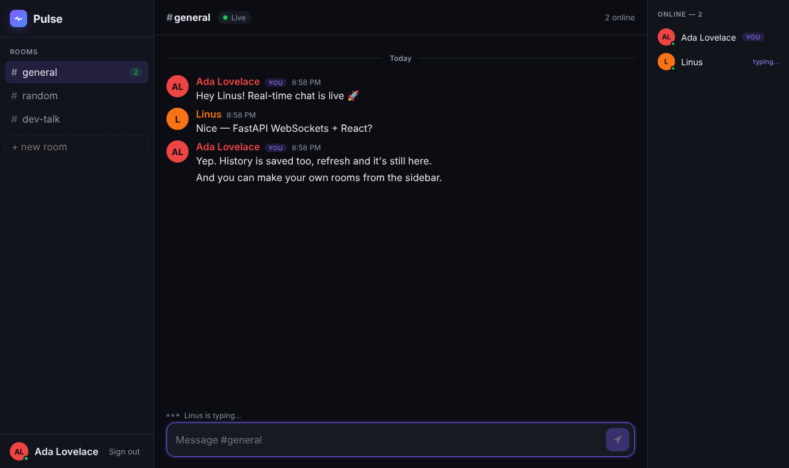
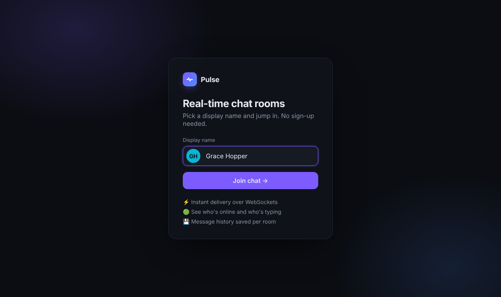
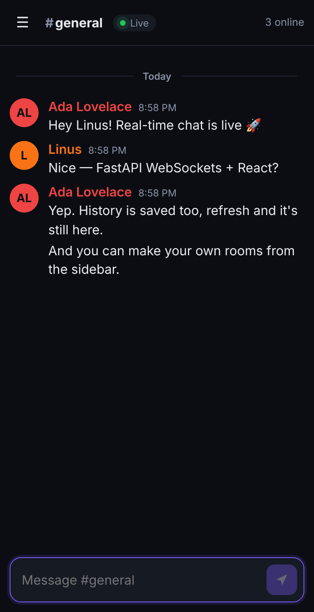

# Pulse · Realtime Chat

A real-time chat app with rooms, live presence and typing indicators. The **FastAPI** backend pushes every message over **WebSockets**, and a **React** frontend renders it the moment it arrives. Message history is stored in **SQLite**, so you can refresh the page and still see the conversation.




| Join screen | Mobile |
|---|---|
|  |  |

## Features

- **Instant messages** over one WebSocket per room, with no polling
- **Rooms:** `#general`, `#random`, `#dev-talk`, plus any room you create from the sidebar
- **Presence:** see who's online in the room, plus live online counts for every room
- **Typing indicators** that clear on their own when someone stops typing
- **History:** the last 50 messages load when you join, stored in SQLite
- **Auto-reconnect** with exponential backoff if the connection drops or the server restarts
- **Guard rails:** unique names per room, input validation, 1,000-character limit, and per-connection rate limiting
- **Responsive** layout with a slide-out room menu on mobile

## How it works

```
 Browser (React)                         FastAPI server
 ───────────────                         ──────────────
 useChat() hook ──── ws://…/ws/{room} ──▶ RoomManager   (who's in which room)
   history / message / presence ◀──────    ├─ broadcast() fan-out to room members
   typing / system / error                 └─ MessageStore (SQLite history)
 Sidebar ─────────── GET /api/rooms ────▶ online counts per room
```

**WebSocket messages**

| Direction | `type` | Payload |
|---|---|---|
| client → server | `message` | `{ text }` |
| client → server | `typing` | `{ is_typing }` |
| server → client | `history` | `{ messages: [...] }`, sent once on join |
| server → client | `message` | `{ id, room, username, text, ts }` |
| server → client | `presence` | `{ users: [...] }` |
| server → client | `typing` | `{ username, is_typing }`, sent to everyone except the typist |
| server → client | `system` | `{ text }`, e.g. "Ada joined" |
| server → client | `error` | `{ text }`, e.g. when rate-limited |

The server closes a socket with code `4409` if the name is already taken in that room, and with `4400` for an invalid room or name.

## Run it locally

**Backend** (Python 3.10+):

```bash
cd backend
python -m venv .venv && source .venv/bin/activate   # Windows: .venv\Scripts\activate
pip install -r requirements.txt
uvicorn app.main:app --reload --port 8000
```

**Frontend** (Node 18+), in a second terminal:

```bash
cd frontend
npm install
npm run dev
```

Open http://localhost:5173 in two browser windows (or one normal and one private window), pick two names, and chat.

**Single server (production style):** run `npm run build` in `frontend/`, then start uvicorn. FastAPI serves the built UI at http://localhost:8000.

## Tests

```bash
# Backend: 12 tests against a real uvicorn server (broadcast, presence, typing, history, validation, rate limit)
cd backend && pip install -r requirements-dev.txt && pytest -q

# End to end: two Chromium browsers chatting (needs the app running on :8000)
pip install playwright && playwright install chromium
python e2e/two_users.py http://localhost:8000
```

GitHub Actions runs all three jobs (backend tests, frontend build, two-browser E2E) on every push.

## Deploy

The repo ships with a multi-stage `Dockerfile` that builds the React app and serves it from FastAPI, plus a `render.yaml`:

1. On [render.com](https://render.com), go to **New → Blueprint** and pick this repo.
2. Render builds the Docker image and gives you a URL like `https://pulse-chat-xxxx.onrender.com`.

Render's free tier sleeps after about 15 minutes idle (the first visit then takes around a minute to wake up), and its disk isn't persistent, so chat history resets on each redeploy. To keep history, attach a persistent disk at `/app/data`.

## Project structure

```
backend/
  app/main.py        FastAPI app: REST + WebSocket endpoints, serves the built UI
  app/manager.py     RoomManager: connections per room, broadcast, presence
  app/store.py       MessageStore: SQLite history
  tests/             pytest suite (runs a live uvicorn server)
frontend/
  src/useChat.js     WebSocket hook: reconnects, presence, typing state
  src/components/    JoinScreen, Sidebar, MessageList, Composer, Avatar
e2e/two_users.py     Playwright two-browser test
Dockerfile, render.yaml, .github/workflows/ci.yml
```

## License

MIT
